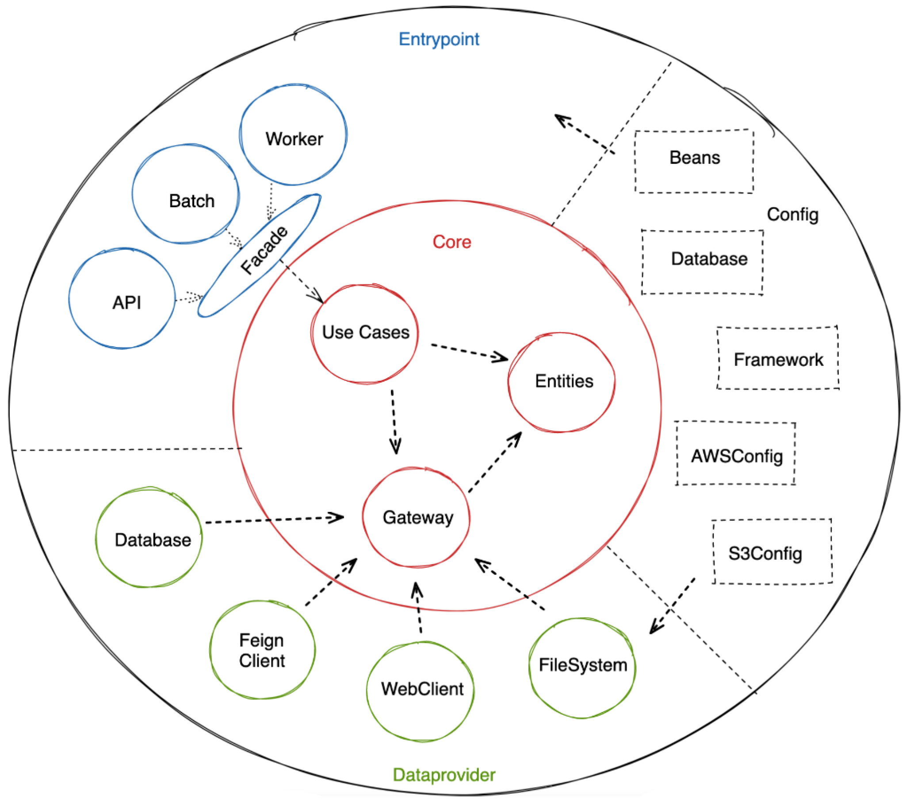

# Spring Studious Lab AWS

Laboratório de empréstimos e pagamentos. A API cria o empréstimo, consulta pelo identificador gerado e
registra o pagamento. Essas três operações gravam no MongoDB. O ambiente local usa Java 25, Spring Boot 4.1.2,
Maven 3.8 ou superior, Docker Compose v2, MongoDB 8.0 e LocalStack 4.14.0.

A documentação, os nomes públicos da API e os comentários novos ficam em português.

## Documentação

O repositório já tem o desenho das camadas, o contrato de I/O e as páginas do Archify. Este README resume o
que o código faz e aponta o arquivo canônico. A tabela de atributos, a obrigatoriedade e os códigos de erro
permanecem no contrato. O HTML é a visualização.

| Documento | O que traz |
| --- | --- |
| [docs/Clean_Architecture.png](docs/Clean_Architecture.png) | Desenho das camadas: entrypoint, core, dataprovider e a faixa de configuração. |
| [docs/archify/arquitetura-camadas-clean/camadas-clean.html](docs/archify/arquitetura-camadas-clean/camadas-clean.html) | A mesma divisão lida contra os módulos que existem hoje. |
| [docs/archify/arquitetura-emprestimos-pagamentos/arquitetura-emprestimos-pagamentos.html](docs/archify/arquitetura-emprestimos-pagamentos/arquitetura-emprestimos-pagamentos.html) | Fluxo das três operações, com os cartões de pedido, resposta e erro. |
| [docs/archify/arquitetura-emprestimos-pagamentos/contrato-io.md](docs/archify/arquitetura-emprestimos-pagamentos/contrato-io.md) | Contrato público de I/O. |
| [AGENTS.md](AGENTS.md) | Comandos, fronteira dos módulos, commits e o estado do código, para quem altera o repositório. |
| [tasks/plan.md](tasks/plan.md) e [tasks/todo.md](tasks/todo.md) | Plano e lista da atualização de saldo com lock otimista. O texto ainda descreve essa etapa como futura. O código já tem o método no repositório, e o HTTP ainda não o chama. O detalhe está na seção "O que o código faz hoje". |

## Arquitetura



O PNG continua sendo o desenho de referência das três camadas. A chamada entra pelo anel de fora, o
`lab-entrypoint`. A facade traduz o DTO e chama o caso de uso no `lab-core`. O caso de uso fala com uma porta.
O `lab-dataprovider` implementa a porta. O core não importa entrypoint nem dataprovider.

A página de camadas registra o que o desenho traz e este laboratório não executa: Batch, Worker, Feign Client,
WebClient, FileSystem e a faixa Config, com Beans, Database, Framework, AWSConfig e S3Config. O módulo
`lab-config` existe. O `Main` dele imprime uma saudação e fica fora do boot. A configuração que vale está no
`application.yml` do entrypoint, no `WebConfig`, no `OpenAPIConfig` e nos adaptadores do dataprovider.

Com `Idempotency-Key`, a reserva da chave acontece antes do caso de uso. Sem a chave, essa ida ao store não
ocorre. A busca de empréstimo sai da facade direto para o caso de uso.

## Como rodar

`docker compose up -d` sobe os três serviços do `compose.yml`:

- `mongo-dev`, imagem `mongo:8.0`
- `localstack`, imagem `localstack/localstack:4.14.0`, com os serviços `sns`, `sqs` e `s3`
- `spring-studious-lab-aws-service`, imagem construída pelo `Dockerfile` e publicada na porta 8082

O serviço da aplicação espera Mongo e LocalStack saudáveis. O `Dockerfile` compila com Maven e Temurin 25 e
roda o JAR do `lab-entrypoint` num JRE 25.

Para deixar só o banco e o LocalStack no Docker e subir a aplicação na máquina:

```bash
docker compose up -d mongo-dev localstack
./mvnw -pl lab-entrypoint -am spring-boot:run
```

No PowerShell, o mesmo arranque usa `.\mvnw.cmd -pl lab-entrypoint -am spring-boot:run`.

A classe é `br.com.springstudiouslabaws.LabEntrypointApplication`, no módulo `lab-entrypoint`, na porta 8082.
Não há profile obrigatório do Spring. Os padrões de `lab-entrypoint/src/main/resources/application.yml`
apontam para o Mongo e o LocalStack em localhost. Dentro da rede do Compose, `MONGODB_URI` e `AWS_ENDPOINT`
usam os hostnames dos containers. Credenciais e URIs locais ficam nesse YAML, no `compose.yml` e no
`.env.example`. O arquivo `.env` não entra no Git.

Os testes:

```bash
./mvnw test
.\mvnw.cmd test
```

A cobertura roda o JaCoCo com 80% de linhas por pacote:

```bash
./mvnw verify
.\mvnw.cmd verify
```

No GitHub Actions, o workflow de build e teste compila com Temurin 25. O repositório também tem análise
CodeQL e o workflow de imagem Docker.

Com a aplicação no ar, o `lab-entrypoint` inclui o springdoc 3.2.0 e o `OpenAPIConfig`. O `application.yml`
não define propriedade `springdoc`. A biblioteca publica a interface em `http://localhost:8082/swagger-ui.html`
e o documento em `http://localhost:8082/v3/api-docs`. O título configurado é "API de empréstimos e
pagamentos".

## Módulos

`lab-core` guarda o domínio, os casos de uso e as portas: repositórios, `IdempotencyStore` e as interfaces de
SQS. Não depende dos outros módulos.

`lab-dataprovider` implementa Mongo e SQS. Depende só do `lab-core`.

`lab-entrypoint` sobe o Spring Boot. Traz controllers, facades, DTOs, mappers e `IdempotentCommand`. Depende
do `lab-core` e do `lab-dataprovider`.

`lab-config` não é a aplicação que sobe. O `Main` desse módulo fica fora do boot.

## Operações HTTP

Os nomes públicos do JSON estão no contrato. Entre eles: `nome`, `pagamentos` e `identificador_emprestimo`.
Campos, obrigatoriedade, formatos e códigos de erro estão em
`docs/archify/arquitetura-emprestimos-pagamentos/contrato-io.md`. Os cartões da página HTML repetem o resumo.

`POST /v1/emprestimos` cria um empréstimo e responde 201. O pedido exige `identificador_cliente`, `nome`,
`email`, `descricao_emprestimo`, `valor_solicitado` e `data_final_vencimento`. O nome tem no mínimo 3
caracteres, o e-mail precisa ser e-mail e o valor fica entre 100.00 e 1000000.00. A data aceita
`dd/MM/yyyy`, `dd-MM-yyyy` ou `yyyy-MM-dd`. O domínio ainda recusa data no passado e prazo menor que 4 meses,
com 422 `BUSINESS_RULE`.

`GET /v1/emprestimos/{loanId}` busca pelo identificador gerado na criação e responde 200. Empréstimo ausente
responde 404 `NOT_FOUND`, com a mensagem "Empréstimo não encontrado". O GET não usa idempotência.

`POST /v1/pagamentos` registra pagamentos e responde 201. O pedido exige `identificador_cliente` e
`pagamentos`, com ao menos um item. Cada item exige `identificador_emprestimo` e `valor_pagamento` (mínimo
0.01). `comentario` é opcional. O caso de uso só grava o pagamento.

A resposta de empréstimo pode trazer `descricao_emprestimo`, `valor_solicitado`, `data_final_vencimento`,
`identificador_emprestimo`, `identificador_cliente`, `nome`, `email`, `status` e `atualizado_em`. Jackson
omite nulos. A resposta declarada do pagamento tem `identificador_cliente` e `pagamentos_efetuados`. O mapper
de volta do Mongo não copia os campos do documento para o domínio, então o 201 pode sair sem esses nomes.

O erro usa um envelope com `error.code`, `error.message` e `error.details`. Cada item de `details` tem
`field` e `message`. Em `BUSINESS_RULE`, `field` vai nulo. Os códigos que o `ApiExceptionHandler` coloca no
envelope, entre eles `VALIDATION_ERROR`, `MALFORMED_REQUEST`, `INVALID_IDEMPOTENCY_KEY`,
`IDEMPOTENCY_IN_PROGRESS`, `IDEMPOTENCY_PAYLOAD_MISMATCH`, `METHOD_NOT_ALLOWED`, `UNSUPPORTED_MEDIA_TYPE`,
`REQUEST_ERROR` e `INTERNAL_ERROR`, estão na tabela de exceções do contrato.

## Idempotência

O cabeçalho `Idempotency-Key` é opcional nos dois POST. Sem a chave, ou com a chave em branco, a ação segue
e repetir o POST cria outro empréstimo ou outro pagamento.

A chave preenchida precisa casar `^[A-Za-z0-9._:-]{1,200}$`. Fora disso, a resposta é 400
`INVALID_IDEMPOTENCY_KEY`. A chave é guardada por escopo: `emprestimos` na criação de empréstimo e
`pagamentos` no pagamento. O id no Mongo é `escopo:chave`, na coleção `idempotency_keys`.

A mesma chave com o mesmo corpo e estado concluído devolve a primeira resposta. A mesma chave ainda em
processamento responde 409 `IDEMPOTENCY_IN_PROGRESS`. A mesma chave com outro corpo responde 422
`IDEMPOTENCY_PAYLOAD_MISMATCH`. Se a ação lança `RuntimeException`, a chave em andamento é apagada e a
retentativa pode começar de novo.

A validação de bean no POST vem antes da idempotência. Corpo inválido responde 422 `VALIDATION_ERROR` e não
grava a chave.

## O que o código faz hoje

Criar um empréstimo valida `LoanDomain`, gera um UUID, preenche `atualizado_em` e grava o status `pendente`
quando o status chega nulo. O pedido HTTP não traz status, então a criação pela API grava `pendente`. O caso
de uso recebe `LoanSQSSendService` e não chama `sendLoan`. O método `sendLoan` existe e está vazio.

Criar um pagamento só salva o pagamento. `CreatePaymentUseCase` recebe o repositório de empréstimo e o envio
SQS e não chama nenhum dos dois. Também não chama `validate` nem `applyDebit`.

A baixa de saldo já está no domínio e na porta, fora das três operações. `OutstandingBalance.afterDebit`
recusa valor nulo, zero ou negativo, saldo indefinido e baixa maior que o saldo. Se o saldo gravado é nulo,
a conta usa `valor_solicitado`. Saldo restante grava `pendente`. Saldo zerado grava `quitado`.
`LoanRepository.applyDebit` carrega o documento `loan`, calcula essa baixa e grava saldo e status na mesma
escrita, reutilizando o `@Version` lido. Falha de lock otimista vira `LoanUpdateConflictException`. Nenhum
caso de uso chama `applyDebit`, e o `ApiExceptionHandler` não tem um código próprio para essa exceção. O
POST de pagamento, portanto, não reduz o saldo.

O enum de status também declara `vencido` e `excedente`. A criação pela API grava `pendente`. A baixa grava
`pendente` ou `quitado`. Nenhuma das três operações atribui `vencido` ou `excedente`.

`tasks/plan.md` e `tasks/todo.md` ainda descrevem o `@Version` e a baixa como fase futura, com as tarefas
dessa fase em aberto. No código, `LoanEntity` já tem `@Version` e `applyDebit` já grava as duas informações
juntas. O que continua de fora é a ligação com o caso de uso de pagamento.

## Mongo e LocalStack

O Compose sobe MongoDB 8.0 com a imagem `mongo:8.0` e o LocalStack com a imagem
`localstack/localstack:4.14.0`. Os scripts em `localstack/` são montados no `ready.d` do LocalStack. Os que
rodam criam o bucket, o tópico `payments-topic`, as filas `payment-partial-queue`, `payment-total-queue` e
`payment-overmeasure-queue`, e assinam as três filas nesse tópico. Os trechos de fila de empréstimo estão
comentados e não criam recurso.

O documento de empréstimo fica na coleção `loan`. A chave de idempotência fica em `idempotency_keys`.
`PaymentsEntity` não declara `@Document` nem `@Id`. O `POST /v1/pagamentos` grava essa entidade pelo Spring
Data.

`PaymentSQSSendServiceImpl` sabe enviar para as três filas. Ninguém chama. Os listeners dessas filas só
escrevem log. `LoanSQSSendServiceImpl.sendLoan` está vazio.

O POM pai declara os starters de S3 e de SNS. Nenhuma classe usa esses serviços. As três operações HTTP não
gravam arquivo no S3, não publicam no SNS e não enviam mensagem ao SQS. O LocalStack sobe esses recursos
para o ambiente local. A gravação das operações fica no Mongo.

## Regras para agente

O guia de quem altera o repositório é o [AGENTS.md](AGENTS.md). As skills padrão citadas lá são
[addyosmani/agent-skills](https://github.com/addyosmani/agent-skills) e
[tt-a1i/archify](https://github.com/tt-a1i/archify).

Quando o contrato público de I/O mudar, atualize
`docs/archify/arquitetura-emprestimos-pagamentos/contrato-io.md` no mesmo trabalho.

Ao usar o Archify (https://archify.si/guide), não faça commit do JSON que ele gera, nem de recibos ou
candidatos. Faça commit do `.html` ou do `.md`. O Markdown do contrato é esse `contrato-io.md`. O HTML de
visualização fica em `docs/archify/`. A pasta `.archify/` está no `.gitignore`.

Documentação nova não copia senha, URI com credencial nem chave padrão. Esses valores locais já estão no
`application.yml` e no Compose.
